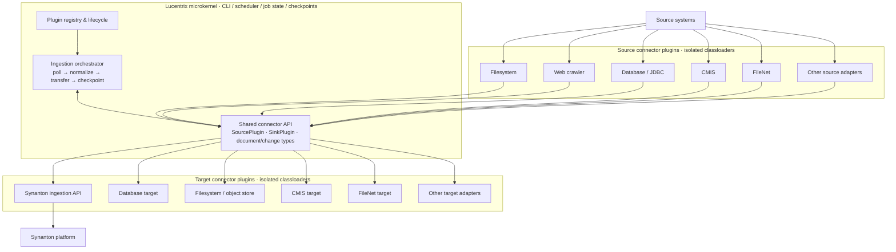

# Lucentrix

Lucentrix is a **pluggable ingestion CLI** for [Synanton](https://github.com/andreminin/synanton). It moves documents between source systems and target systems through small connector plugins. Synanton remains responsible for parsing, chunking, enrichment, and indexing.

## Architecture

Lucentrix uses a microkernel model: the core owns orchestration and shared connector contracts; plugins own system-specific integration. Each connector plugin is isolated in its **own classloader**, so connector dependencies can differ without leaking into the core or other plugins. Plugins communicate through the stable API, not through one another's implementation classes.



**Classloader boundary:** each plugin gets a dedicated classloader for its implementation and third-party libraries. The connector API/domain contracts are shared from the host API classloader. The kernel coordinates plugins; plugins do not load or call each other's implementation classes directly. This is the intended isolation boundary, not an operating-system security sandbox.

## Connector catalog

The connector API separates **sources** (read/change discovery) from **targets** (write/delivery). A connector may implement one role or both.

| Connector | Role | Status |
|---|---|---|
| `dummy-source-plugin` | Synthetic insurance documents | Implemented |
| `web-source-plugin` | BFS HTML crawler | Implemented |
| `filesystem-source-plugin` | Incremental PDF/EPUB crawler, SHA-256 fingerprints, resumable scan state and complete-scan deletion reconciliation | Implemented |
| `synanton-target-plugin` | Upload documents to Synanton's ingestion API | Implemented |
| `null-target-plugin` | No-op sink for local throughput tests | Implemented |
| FileNet | Source and/or target adapter | Planned |
| CMIS repositories | Source and/or target adapter | Planned |
| JDBC databases | Source and/or target adapter | Planned |
| Filesystem / object storage target | Target adapter | Planned |
| Additional enterprise content repositories and APIs | Source and/or target adapters | Extension points |

Planned entries describe the connector architecture and are **not shipped implementations**. Connector availability should be updated here as each plugin is delivered.

## Requirements

- Java 21
- Maven

## Build

```bash
mvn -DskipTests package
```

The Spring Boot CLI is `ingestion/crawler`. Plugin ZIPs are produced under `plugins/*/target`.

## Run

1. Start the Synanton platform (Cassandra, MinIO, synvault, synflux, synquest). See the Synanton README ingestion demo.
2. Copy `application.properties` next to the CLI (or use the packaged `config/`).
3. Point the source and target plugins at their configuration:

```properties
source.plugin.id=dummy-source-plugin
target.plugin.id=synanton-target-plugin
dummy-source-plugin.config=config/dummy.json
synanton-target-plugin.config=config/synanton.json
```

`config/synanton.json`:

```json
{
  "name": "synanton",
  "baseUrl": "http://<platform-node-ip>:30090",
  "apiKey": "<bearer token minted from the platform JWT secret>",
  "sourceId": "books-demo",
  "connectorId": "upload",
  "sourceEndpoint": "upload://books"
}
```

`baseUrl` is the platform `/v1` API (the synflux NodePort in the demo).
`apiKey` is the bearer token; the tenant comes from the token, never from a
request header. The sink registers the upload source once, then posts each
file as `multipart/form-data` to `POST /v1/ingestion-runs` with
`connector_id`, `source_id`, `resource_id`, and the file bytes. The legacy
`synfluxUrl`/`tenant` fields are not used by the current contract.

4. Start the CLI (status UI on port 8095 by default):

```bash
java -jar ingestion/crawler/target/crawler-0.1.0-SNAPSHOT.jar
```

Open http://localhost:8095 and click **Start**, or run once without the UI:

```bash
java -jar ingestion/crawler/target/crawler-0.1.0-SNAPSHOT.jar ingest --once --no-ui
```

- `--ingest` / non-option `ingest` starts a job immediately
- `--once` / `--no-ui` exits when the source is idle
- `GET /api/ingest/status` and `GET /api/ingest/events` (SSE) expose progress
- `POST /api/ingest/start` and `POST /api/ingest/stop` control the job from the UI

## Connector contract

Source plugins implement `SourcePlugin`; target plugins implement `SinkPlugin`. Shared domain types include `SourceDocument`, `ContentChange`, `ChangeOp`, and `ChangePage`. Keep connector-specific libraries and models inside the plugin boundary; exchange only API contract types with the kernel.

## Current implementation status

*Phase 1 — checked 2026-10-21.*

The filesystem source and `synanton-target-plugin` use the current
`POST /v1/sources` + multipart `POST /v1/ingestion-runs` contract. The legacy
`/content/{tenant}` and `/ingest` paths are removed and are not supported by
the sink.

Uploads can be large (the platform accepts multipart files up to its 100 MB
limit), but the platform's synchronous extraction ceiling
(`EXTRACTION_MAX_SYNC_OBJECT_BYTES`, default 10 MiB) still applies. Larger
files need the asynchronous extraction path/configuration.

A re-crawl treats `409` from `/v1/sources` as “source already exists” and
continues with the upload.

## Pull request convention

For a PR that completes only one slice of a larger issue, reference it as
`Refs #N`; do not use `Closes #N` / `Fixes #N`. Close the issue only when its
acceptance evidence is merged.

## Docs

- [`docs/synanton_ingestion.md`](docs/synanton_ingestion.md) — ingestion architecture (proposed design)
- [`docs/ticket-16-filesystem-source-connector.md`](docs/ticket-16-filesystem-source-connector.md) — plan for the filesystem source connector (#16)

## License

Apache 2.0 — see [LICENSE](LICENSE).
